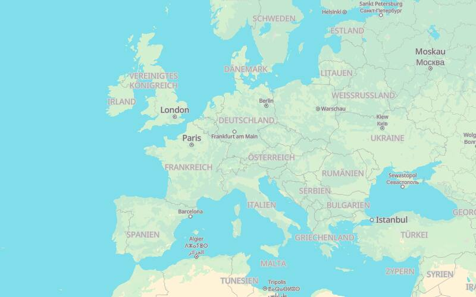
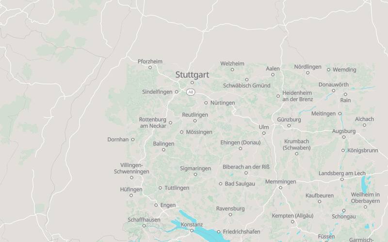
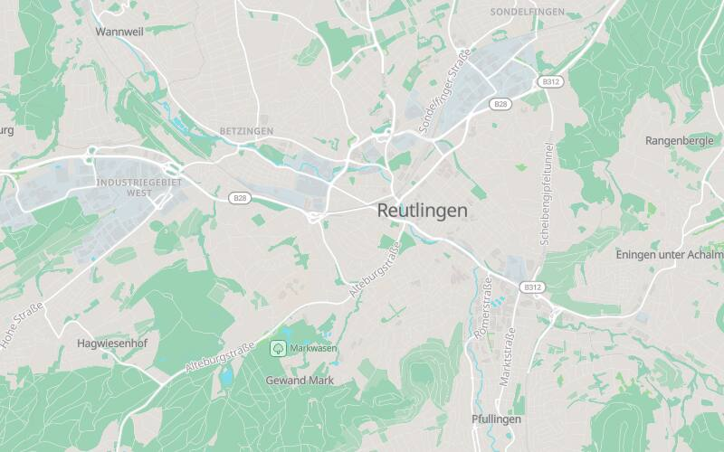
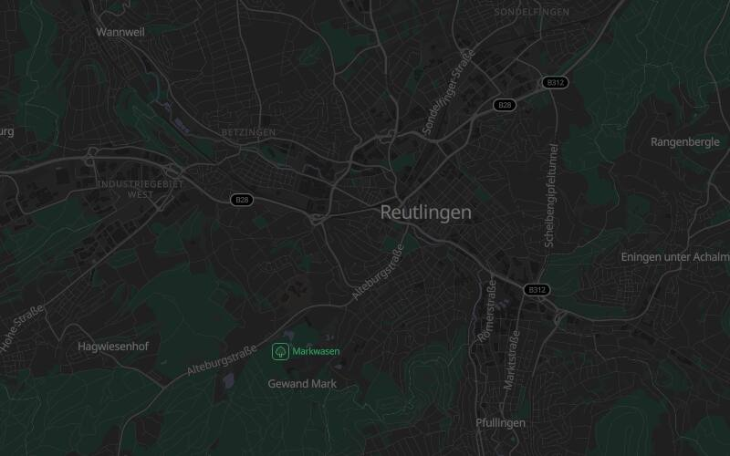
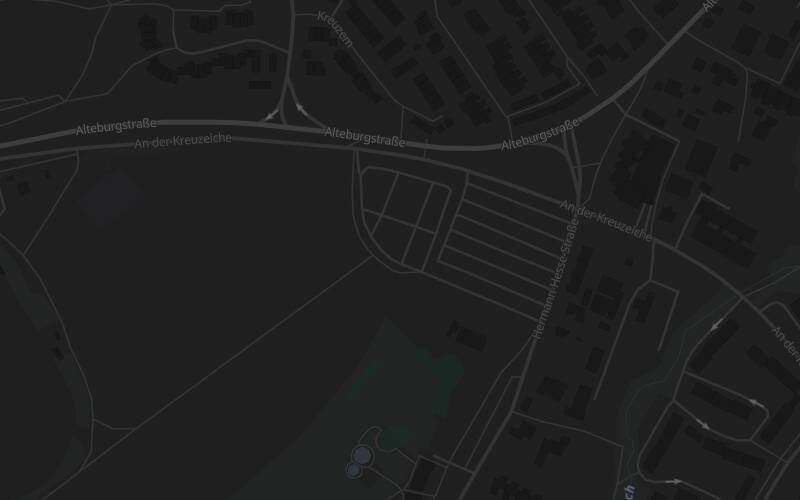

# Karten-Daten (Tiles, Style, Glyphen, Sprites)

Die Karten laufen komplett auf eigener Origin: PMTiles-Archive unter `/tiles/`, Style, Glyphen und Sprites unter `/map-style/`. Kein Fremd-Origin, kein Tile-Dienst von Dritten. Die Tiles liegen **nicht im Git**; `scripts/build-tiles.sh` erzeugt sie aus einem gepinnten Protomaps-Build, `deploy/tiles.lock` hält die Pins und Prüfsummen.

## Aufruf

| Befehl | Wirkung |
|---|---|
| `scripts/build-tiles.sh` (`fetch`) | extrahiert `deploy/tiles/world.pmtiles` (Welt, Zoom 0 bis 5) und `deploy/tiles/reutlingen.pmtiles` (bbox 9.05,48.40,9.35,48.58, Zoom 0 bis 15) aus dem gepinnten Build, ungefähr 2 min, 32,5 MB. Schreibt über `.part`, prüft `pmtiles verify` und SHA-256, benennt erst dann um |
| `scripts/build-tiles.sh verify` | prüft `deploy/tiles/` gegen `tiles.lock`, offline |
| `scripts/build-tiles.sh install` | kopiert die Dateien über einen Wegwerf-Container in das Compose-Volume `tiles_data` und prüft sie dort erneut |
| `scripts/build-tiles.sh assets` | lädt Glyphen und Sprites von `protomaps/basemaps-assets` am gepinnten Commit (Tarball-SHA-256 in `tiles.lock`) nach `frontend/public/map-style/` |
| `scripts/build-tiles.sh bump <YYYYMMDD>` | pinnt einen neuen Build und schreibt die neuen Prüfsummen in `tiles.lock` |
| `deploy/tiles-smoke.sh [base-url]` | prüft gegen einen laufenden Stack: Range-Request ergibt 206 mit `Content-Range`, `Accept-Ranges: bytes`, kein `Content-Encoding`, starkes ETag, Cache-Control, ein CSP-Header |

`pmtiles` 1.31.2 wird aus dem PATH genommen, sonst aus `nix build nixpkgs#pmtiles`, sonst als gepinntes Release-Binary (SHA-256 in `tiles.lock`). Der Download ist **nur** im Skript; Tests und CI laden nie Tiles.

## Ablauf nach Ablauf der Woche

Der Protomaps-Bucket hält nur die Builds der letzten Woche. Ist `PROTOMAPS_BUILD` abgelaufen, meldet `fetch` "Build abgelaufen". Dann:

1. `scripts/build-tiles.sh bump <aktuelles Datum>`: neue Pins und Prüfsummen, Größenvergleich.
2. Diff von `deploy/tiles.lock` prüfen, `scripts/build-tiles.sh fetch`, Karten im Dev ansehen.
3. `scripts/build-tiles.sh install` auf dem Zielhost, Commit der Lock-Datei.

Solange die Dateien im Volume liegen, läuft der Betrieb auch nach Ablauf des Builds weiter; nur ein Neuaufbau braucht einen aktuellen Pin. Der Pin ist nur eine Integritätsprüfung, kein dauerhafter Bezugsweg: nach etwa einer Woche gibt es den Build nicht mehr.

### Sicherung der Quelle

Die verifizierten Archive (`world.pmtiles`, `reutlingen.pmtiles`) sind die einzige reproduzierbare Quelle und gehören nach jedem erfolgreichen `fetch` plus `verify` in die Sicherung:

1. Auf dem Zielhost liegt `tiles_data` (Compose-Volume) im borg-Lauf der Cloud-Sicherung; das Volume ist die Sicherungsquelle, solange `install` es gefüllt hat.
2. Zusätzlich je Bump die beiden Dateien samt `deploy/tiles.lock` (Prüfsummen) auf die Storagebox legen, Verzeichnis `tiles/<PROTOMAPS_BUILD>/`.
3. Ein Neuaufbau ohne gültigen Pin geht dann aus der Storagebox: Dateien nach `deploy/tiles/` kopieren, `scripts/build-tiles.sh verify`, `install`.

`install` läuft nur nach erfolgreichem `verify` des Quellordners und prüft das Volume danach erneut; ein Volume mit abweichenden Dateien kann also nicht still entstehen. Das Einrichten des Storagebox-Pfads ist die offene Weiche W-C3 (Betriebsentscheidung, nicht im Repo).

## Dev

`deploy/docker-compose.dev.yml` startet den Dienst `tiles` (nginx, `127.0.0.1:8083`, bindet `deploy/tiles`); `frontend/proxy.conf.json` leitet `/tiles` dorthin (Range läuft durch). `deploy/dev-up.sh` weist auf `scripts/build-tiles.sh` hin, wenn die Dateien fehlen.

## Produktion

`web` mountet das Volume `tiles_data` read-only unter `/usr/share/nginx/tiles`. `location ^~ /tiles/`: statisch mit `Accept-Ranges`, `gzip off` (die Archive sind intern gzip, ein schwaches ETag oder `Content-Encoding` bräche das PMTiles-JS), `access_log off`, `Cache-Control: public, max-age=604800` (7 Tage), Rate-Limit `ev_tiles`. Der Service-Worker lässt `/tiles/**` unberührt (keine Cache-Gruppe, `ngsw-bypass` im Client).

## Style, Glyphen, Sprites

`frontend/public/map-style/` enthält:

- `style-light.json`, `style-dark.json`: erzeugt von `scripts/gen-map-style.mjs` aus `@protomaps/basemaps` (BSD-3-Clause). Zwei Quellen `world` und `region`. Pins, Cluster und Gebäudeflächen setzt `app-map` zur Laufzeit.
- `fonts/<Schrift>/<Bereich>.pbf`: Noto Sans Regular, Medium und Italic, nur die Bereiche `0-255`, `256-511`, `7680-7935`, `8192-8447`, `8448-8703` (Latein inkl. Umlaute, Satzzeichen, Euro). Fehlende Bereiche (kyrillisch, arabisch) ergeben 404 für einzelne Glyphen; das ist gewollt.
- `sprites/v4/{light,dark}{,@2x}.{json,png}`.

## Lizenzen

| Teil | Lizenz | Pflicht |
|---|---|---|
| Kartendaten (OpenStreetMap über Protomaps Basemap) | ODbL 1.0, Produced Work | Namensnennung "© OpenStreetMap" sichtbar auf der Karte (steht auch in den Archiv-Metadaten) |
| Protomaps-Basemap-Schema, `@protomaps/basemaps`, `pmtiles`, `maplibre-gl` | BSD-3-Clause | Lizenztext bleibt in den Paketen |
| Schriften Noto Sans | SIL OFL 1.1 | `fonts/OFL.txt` liegt bei |
| Sprites und Assets `protomaps/basemaps-assets` | siehe Repo (Code BSD-3, Schriften OFL) | `PROVENANCE.map-assets.json` hält Quelle und Commit |

## Gemessene Befunde (2026-10-25)

- **Sprite-URL muss absolut sein.** MapLibre 6.13 lehnt `"sprite": "/map-style/sprites/v4/light"` mit `Invalid sprite URL ..., must be absolute` ab. Die Style-Dateien sind statisch und kennen die Origin nicht, also macht `app-map` die URL beim Laden absolut (`new URL(style.sprite, location.origin).href`, am einfachsten nach dem `fetch` des Styles, bevor das Objekt an `Map({style})` geht). Glyphen-URLs dürfen relativ bleiben.
- **CSP.** Gegen den echten nginx mit der Produktions-CSP (`worker-src 'self'`, kein `blob:`, kein `unsafe-eval`) laufen Hauptthread, Modul-Worker `/map/maplibre-gl-worker.mjs`, PMTiles-Range-Requests, Glyphen und Sprites ohne Verstoß. Getestet in Chromium (`channel: 'chromium'`, WebGL2) mit einer Wegwerf-Seite.
- **Übergabe Welt zu Region bei Zoom 7** zeigt bei Zoom 7 bis 8 am Rand der Region einen sichtbaren Sprung (feinere Landnutzung in der Region). Gewollt; wer ihn ruhiger will, erhöht `HANDOFF_ZOOM` in `scripts/gen-map-style.mjs`.
- `Accept-Ranges: bytes` sendet nginx nur auf 200 und HEAD, nicht auf 206; ein zusätzliches `add_header` würde dort doppeln. `deploy/tiles-smoke.sh` prüft deshalb HEAD.

## Screenshots (Style, Wegwerf-Seite)

| Hell, Welt Zoom 3 | Hell, Zoom 7 | Hell, Reutlingen Zoom 12 |
|---|---|---|
|  |  |  |

| Dunkel, Zoom 12 | Dunkel, Zoom 16 (Alteburgstraße) |
|---|---|
|  |  |
